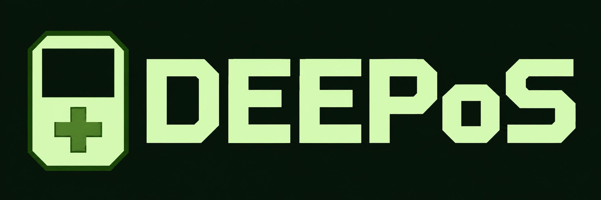

  

# DEEPoS

Лёгкая открытая прошивка для портативной консоли **R36S‑V20** на Rockchip
RK3326. DEEPoS оставляет память и процессор играм: лаунчер рисует кадры
напрямую, системные службы сведены к необходимым, диагностические модули
работают по запросу. Другим ревизиям R36S и клонам может потребоваться своя
конфигурация платы, панели и кнопок.

**[Установка прошивки][install]** · **[Разработка][development]** ·
**[Спецификация][spec]** · **[Образы и контрольные суммы][releases]**

## Возможности тестовой версии 0.41

- Меню на русском, нативный вывод 640×480, навигация геймпадом, короткие
  звуки интерфейса и экран показаний CPU, GPU, температуры, ОЗУ и батареи.
- Библиотека игр с TF1 и TF2. Каталоги ROMS доступны с ПК через картридер
  или USB‑режим. В списке игр виден источник файла.
- RetroArch и ядра AArch64 в сборках с комплектом эмуляторов.
  **X** открывает выбор ядра для системы, **Select + Start** возвращает из
  RetroArch в лаунчер. В расширенном комплекте доступны 118 ядер ARM64.
- PortMaster доступен в расширенной сборке через **Игры → Порты**.
  Клиент и его библиотеки загружаются при запуске.
- Плитки яркости, звука, профиля CPU, даты, времени и региона.
  USB‑сеть получает настройки через DHCP от хоста.
- Модули батареи, хранилища и эмуляторов. Для модулей есть переключатель по A,
  описание по Y, действие по X и импорт собственных пакетов через ROMS.

Подробнее об [эмуляторах](docs/EMULATORS.md), [файлах BIOS](docs/BIOS.md),
[установке модулей](docs/MODULES.md)
и [работе PortMaster](docs/PORTMASTER.md). Поддержка каждой системы зависит
от доступного эмулятора, BIOS и формата игры. Для Atari ST и картриджей MSX
есть [свободный комплект BIOS](bios/). Игры и дампы BIOS производителя
пользователь добавляет самостоятельно.

## Как устроена система

Ревизия платы и загрузка описаны в Device Tree и Linux 6.12. BusyBox запускает
систему и приложение на C11. Лаунчер использует fbdev и evdev, игровой стек
поставляется отдельно от корневой системы. Два слота squashfs позволяют
обновлять систему отдельно от настроек и ROM. Каталог DATA хранит конфигурацию,
модули и компоненты эмуляторов, ROMS использует exFAT для обмена с ПК.

Проектные цели — **до 150 МБ ОЗУ в простое**, **до 12 секунд до меню** и
**до шести фоновых служб**. Измерения привязаны к сборке и плате.
[Метрики](docs/metrics.md) · [Журнал](docs/journal.md)

## Участие в проекте

Начните с [инструкции разработчика][development]. В ней есть стек, порядок
сборки, тесты, работа вручную и с ИИ‑агентом. Для первого запуска и записи
карты используйте [инструкцию по установке][install].

Код DEEPoS распространяется под [MIT](LICENSE). У компонентов сторонних
проектов действуют их собственные лицензии.

[install]: docs/INSTALL.md
[development]: docs/DEVELOPMENT.md
[spec]: docs/FIRMWARE-SPEC.md
[releases]: docs/RELEASE.md
