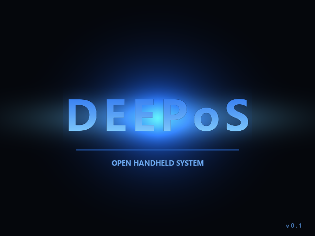

# DEEPoS

**DEEPoS** — лёгкая open-source прошивка для портативных консолей на Rockchip RK3326
(Data Frog R36S и клоны: `R36S-V20`, K36, G80CA, R36H, R36T…).

Слоган: **OPEN HANDHELD SYSTEM**

Цель проекта — система, которая:

1. **не грузит железо**: ≤ 150 МБ ОЗУ в простое, загрузка ≤ 12 с, ≤ 6 демонов;
2. **тянет тяжёлые игры без вылетов и фризов**: нет OOM-kill, PSI-контроль, presqueeze;
3. **поддерживает все консоли**, что были в стоковых прошивках (175 систем);
4. **обратно совместима**: ROM, `gamelist.xml`, сейвы, конфиги RetroArch, порты PortMaster.



---

## Что в этом репозитории

| Путь | Что |
|---|---|
| `docs/FIRMWARE-SPEC.md` | **главный документ**: архитектура, драйверы, UI, модули, сейвы, совместимость, память, этапы P0–P7, тесты, правила работы агента |
| `docs/FIRMWARE-ARCH.md` | история решений и обоснований (v0.1), помечен как история |
| `docs/GUIDE.md` | практическая инструкция: прошивка Arch-R/нашей сборки, USB-сеть, SSH, батарея, нагрев |
| `docs/RUNBOOK.md` | короткий runbook по sysfs-командам и тюнингу |
| `docs/GAMES-PLAN.md` | что и как играть на RK3326: классы производительности, топы игр |
| `docs/SHOPPING-LIST.md` | каталог проверенных портов и игр со ссылками (без ромов/биосов) |
| `docs/AGENT-HANDOFF.md` | передача контекста другому агенту (обезличено) |
| `branding/` | логотип и загрузочный сплэш: PNG, **24-bit BMP 640×480** для U-Boot, иконки, генератор `make-logo.py` |
| `ui/` | макеты лаунчера (HTML) + скриншоты + скрипты рендера |

---

## Быстрый старт для агента

```text
1. Прочитать docs/FIRMWARE-SPEC.md §1 (концепция), §13 (этапы), §17 (правила).
2. Ветка: feat/p0-boot. Первый шаг — bootstrap-образ: загрузчик и DDR-init
   берём из проверенного Arch-R clone, свой только KERNEL + DTB + extlinux.
3. Снять UART-лог (115200), зафиксировать в docs/journal.md.
4. Двигаться строго по этапам P0 → P1 → … → P7, каждый этап — тестами T1–T12.
```

---

## Железо (кратко)

| Узел | Значение |
|---|---|
| SoC | RK3326, 4× Cortex-A35, OPP 408 / 816 / 1008 / 1416 МГц |
| GPU | Mali-G31 MP2, 200 / 300 / 400 / 650 МГц |
| RAM | 1 ГБ LPDDR3 (Nanya `NT6CL256M32-H1`) |
| Экран | 640×480 MIPI-DSI, Sitronix ST7703, reset GPIO3_B7 |
| PMIC | RK817 (батарея 804068 3500 мА·ч, кодеки, LED) |
| USB | один dwc2 OTG (данные) + отдельное гнездо CHARGE |
| Носитель | microSD (eMMC нет) |

---

## Чего здесь нет

Ромов, BIOS, образов коммерческих игр и чужих оболочек. Только код, документация и собственные
артефакты проекта. Ссылки в `SHOPPING-LIST.md` ведут на сторонние каталоги портов — используйте
их с учётом лицензий и законодательства вашей страны.

---

## Лицензия

MIT — см. [LICENSE](LICENSE). Брендинг (логотип DEEPoS) распространяется по той же лицензии.
