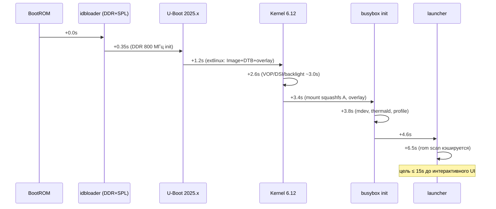
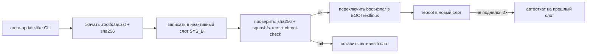
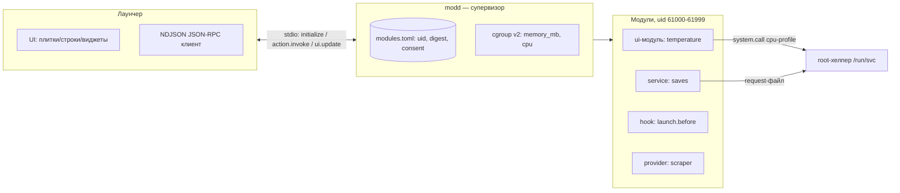
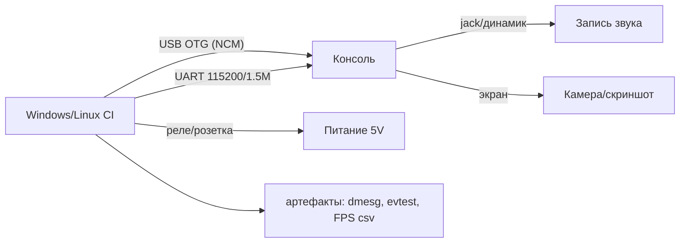

> **СТАТУС: ИСТОРИЯ.** Этот документ (v0.1) — рабочие заметки и обоснования. Актуальная спецификация для разработки — `FIRMWARE-SPEC.md` v1.0 (там же таблица «спорные моменты и как решены»).

# R36S-V20 (клон) — собственная прошивка с нуля
## Архитектура, план разработки, тесты и бенчмарки

| | |
|---|---|
| Версия документа | 0.1 (план, без кода) |
| Дата | 2026-11-18 |
| Устройство | R36S-V20, плата `R36S-V20 2025-05-18`, клон |
| Текущая ОС | Arch-R 3.0.3, ядро 6.12.114, лаунчер `archr-launcher` |
| Статус | исследование + проектирование; код не пишется по требованию заказчика |

---

## 0. TL;DR и вердикт по цели «≤20 % ОЗУ»

**Цель реальна, но требует уточнения формулировки.**

1. «Arch-R занимает 40 % ОЗУ» — это **idle-потребление 263–318 МБ из 731 МБ** (36–43 %). Из них на пользовательские процессы приходится ~50 МБ (`archr-launcher` 32 МБ, `sway` 8 МБ, `systemd`+`resolved`+`sshd` ~19 МБ), остальное — ядро, page cache и slab. То есть 40 % — это не «тяжёлый лаунчер», а **полноценный systemd-дистрибутив с композитором и файловым кэшем**.
2. Собственная прошивка на **Buildroot + mainline Linux + busybox init + свой лаунчер 25–35 МБ** даёт **idle 65–95 МБ (9–13 % от 731 МБ, включая ядро)**. Цель «≤20 %» (≤146 МБ) достигается с запасом.
3. **Во время эмуляции 20 % не удержать и не нужно**: PPSSPP = 120–180 МБ RSS, RetroArch+ядро = 60–90 МБ, Dreamcast/Flycast = 90–130 МБ. Игра на PSP = 250–350 МБ суммарно (34–48 %). Обещать «20 % под игрой» технически нельзя ни на одной прошивке этого класса — нужно разделять **idle-бюджет** и **игровой бюджет** (§6.2). Под тяжёлые игры выигрыш даёт не магия, а «меньше соседей»: −30 МБ лаунчер, остановка служб, сброс кэша, zram (§6.4); ожидаемый эффект — +150–200 МБ доступной памяти и стабильность (без OOM-kill), а не +30 % FPS.
4. **Модульность закладывается сразу** (§8.1): API — NDJSON JSON-RPC, совместимый с Arch-R, поэтому уже написанные нами модули `thermal` и `saves` переносятся почти без изменений; сторонний модуль ставится с явными правами и не может уронить систему.
5. **Сейвы и resume** (§8.2): атомарная запись, 5 автослотов с превью, «Продолжить с места» по A, зеркало на exFAT для ПК, перенос сейвов из ArkOS/Arch-R.
6. Главный риск проекта — **не пользовательское пространство, а bring-up железа**: DDR-инициализация, DSI-панель ST7703, драйвер геймпада (ADC-стики + 17 кнопок), усилитель звука по GPIO. Хорошая новость: **Arch-R clone-образ уже грузится на этой exact-плате**, значит готовая цепочка `idbloader → U-Boot → mainline 6.12 → DTB` существует и её можно взять за основу P0.
7. Оценка трудозатрат соло: **MVP (грузится, драйверы, лаунчер, модули, сейвы) ≈ 38–49 рабочих дней**, полный продукт с PortMaster-совместимостью и CI/HIL ≈ **62–89 дней**. Ниже — этапы P0–P7 с DoD.
8. **Железо выжато на 90–95 %** (§2.4): 1416 МГц и GPU 650 — это максимум нашего DTB; остаточный резерв — 1512 МГц с турбо-OPP и нормальным охлаждением (+0…5 % в играх), режим шины SD и тюнинг памяти. Всё остальное — либо пайка (2 ГБ RAM, Wi-Fi), либо другой класс устройства. Поэтому прирост производительности надо брать **собственной прошивкой** (минус 170…220 МБ ОЗУ в простое) и настройками эмуляторов, а не разгоном.

---

## 1. Требования

### 1.1 Функциональные (F)

| ID | Требование | Приоритет |
|---|---|---|
| F1 | Загрузка с microSD на R36S-V20 (клон), без eMMC | Must |
| F2 | Дисплей 640×480 ST7703 MIPI-DSI, картинка без артефактов, яркость регулируется | Must |
| F3 | 17 кнопок + 4 оси стиков, корректная раскладка (A/B не перепутаны), hotkeys | Must |
| F4 | Звук: динамик (SPKO + `spk-con-gpio`) и наушники (jack detect), громкость | Must |
| F5 | USB OTG: gadget-сеть (NCM) + SSH/scp, MTP (передача файлов), host-режим (геймпад/флешка) | Must |
| F6 | Питание: зарядка, индикация LED (красный/синий), проценты батареи, корректный suspend/resume | Must |
| F7 | Эмуляторы: RetroArch + набор ядер, PPSSPP, Flycast, DuckStation, DraStic-аналог, Mupen64Plus | Must |
| F8 | Пользовательские порты PortMaster (glibc-бинарники) | Should |
| F9 | Сохранения/состояния на отдельном разделе, бэкап и восстановление | Must |
| F10 | Обновление системы атомарное (A/B), откат при сбое | Must |
| F11 | Настройки: язык (ru/en), раскладка, яркость, звук, профили CPU/GPU, Wi-Fi-донгл | Should |
| F12 | Скриншоты, сервисный режим (USB-сеть + shell), логи на SD | Should |
| F13 | Модульность: сторонние модули (UI/сервис/хук/провайдер) ставятся без пересборки, с явными правами и изоляцией | Must |
| F14 | Сейвы и состояния: атомарное сохранение, 5 автослотов, превью, «Продолжить с места» по A | Must |
| F15 | UI: минималистичный, разбит на разделы, **без анимаций, прозрачностей и композитора**; в покое кадры не рисуются; перерисовка только изменённых областей | Must |
| F16 | Настройки — те же, что в текущей прошивке (Арх-Р): язык, управление/A-B, дисплей, звук, сеть (USB-gadget/SSH/Samba/HTTP), питание и профили CPU/GPU, обновления, модули, сведения; плюс импорт ключей из `system.cfg` при первом запуске | Must |
| F17 | Расширяемость UI: страницы и строки настроек из модулей (декларативно, без пересборки лаунчера) | Must |

### 1.2 Нефункциональные (N)

| ID | Требование | Метрика |
|---|---|---|
| N1 | Idle RAM | ≤ 146 МБ (20 % от 731 МБ), stretch ≤ 110 МБ |
| N2 | Время до лаунчера | ≤ 15 с; до консоли ядра ≤ 6 с |
| N3 | Температура | idle ≤ 55 °C; 30-мин нагрузка 4 потока ≤ 80 °C без троттлинга (порог 85 °C) |
| N4 | Автономность | ≥ 4 ч MD/SNES, ≥ 3 ч PS1, ≥ 2 ч PSP (батарея 3500 мА·ч, ~3100 реальных) |
| N5 | Надёжность ФС | 10 циклов отключения питания без потери данных |
| N6 | Воспроизводимость сборки | Docker + Buildroot, побайтово идентичный rootfs (или sha256 манифест) |
| N7 | Размер образа | ≤ 1.6 ГБ сжатого (как Arch-R clone 1.52 ГБ) |
| N8 | Диагностика | UART 115200 на гребёнке, `/var/log` на SD, `dmesg` доступен |
| N9 | UI-процесс | RSS ≤ 15 МБ с кэшем обложек (пик ≤ 18 МБ); 0 кадров в покое; первый кадр ≤ 1.5 с от старта лаунчера |
| N10 | Отзывчивость UI | реакция на кнопку ≤ 50 мс (перерисовка выделения), скролл списка ≤ 16 мс/строку при удержании |

### 1.3 Критерии приёмки релиза (Definition of Done)

- [ ] Все пункты F1–F6, F9–F10, F13–F14 проверены на HIL-стенде (§12.2) на этой exact-плате.
- [ ] Idle RAM ≤ 146 МБ (замер `MemAvailable` + суммарный RSS, §13.1).
- [ ] Boot ≤ 15 с по UART-таймстемпам (медиана 10 прогонов).
- [ ] Матрица «система × эталонный ROM» проходит с FPS не ниже baseline (§13.4).
- [ ] Порты: ≥ 20 тайтлов PortMaster запускаются и сохраняются (список из 20 тайтлов — §13.4).
- [ ] Модули: сторонний модуль из `.tar` устанавливается, показывает запрошенные права, работает в изоляции; `kill -9` модуля не влияет на систему.
- [ ] Сейвы: kill -9 и power-cut во время игры не теряют SRAM и последний валидный слот; «Продолжить с места» запускает игру в последнем слоте.
- [ ] Термо-соак 2 ч: без троттлинга ниже 1008 МГц, без OOM.
- [ ] Power-cut ×10 без потери сейвов и без кирпича.
- [ ] Документация: сборка, прошивка, восстановление (как GUIDE.md в этом репозитории).

---

## 2. Исходное состояние: замеры и факты

### 2.1 Что измерено на этой консоли (Arch-R 3.0.3 / 6.12.114)

| Параметр | Значение | Как получено |
|---|---|---|
| RAM total | 749 544 кБ (731 МБ), `MemAvailable` idle 414–468 МБ | `/proc/meminfo` |
| RAM used idle | 263–318 МБ (36–43 %) | там же |
| Крупнейшие процессы | `archr-launcher` 32 МБ, `sway` 8 МБ, `systemd` 8 МБ, `resolved` 6 МБ, `sshd` 5–6 МБ | `ps -o rss` |
| zram | 1536 МБ, в рантайме `lzo-rle` (zstd прописан, но не активен) | `zramctl`, `swap.conf` |
| CPU OPP | 408 / 816 / 1008 / 1416 МГц; 1512 недоступно (нет `cpufreq/boost`, `vdd_arm` max 1.35 В) | `scaling_available_frequencies` |
| GPU OPP | 200 / 300 / 400 / 650 МГц, `simple_ondemand` | `devfreq` |
| Температура | idle 48–53 °C; стресс 4 потока × 45 с на 1416 МГц → SoC 79.6 °C, GPU 72.9 °C | `thermal_zone*` |
| Трип-точки | 70 °C passive, **85 °C passive (троттлинг)**, 115 °C critical, hyst 2000 | `trip_point*` |
| Батарея | узел `battery`, `charge_full` 3 500 000 (rw), design 4 000 000, health 87.5 %, банка CSD 804068 3500 мА·ч | `power_supply` |
| Батарея, поведение | скачки 32→66 % при подключении зарядки; в dmesg `OCV … disagrees with soc, recalibrating` | `dmesg` |
| Диски | `/` 5.9 ГБ (72 %), `/flash` 256 МБ ro, `/storage` 8 ГБ, `/storage/roms` 36 ГБ exFAT | `df -h` |
| USB gadget | NCM работает (`gadget` <console-ip> + <console-ip>), RNDIS **не собирается** на этом ядре | `usbgadget status` |
| Потолок RAM на процесс | ~400–450 МБ; быстрее → global OOM kill | тесты malloc |
| MangoHud | есть, `/usr/bin/mangohud` | — |

### 2.2 Что говорит сообщество (4PDA тема 1083917, 15 112 ответов)

| Факт | Источник |
|---|---|
| ArkOS «легче» ROCKNIX по памяти, отсюда быстрее порты | пост #14139 (OMOIKANE) |
| Загрузка ArkOS 20–30 с | пост #14138 |
| На клонах OTG не работает на всех системах семейства ArkOS; лечится скриптом смены `dr_mode` | пост #144886162, #146016265 (`github.com/Nikobraz/dArkOSen-R36S-Scripts`) |
| OTG как хранилище: `Network settings → USB Device Function → File_Transfer` | пост #145840801 |
| Плата `R36S-V20 2025-05-18` — клон (таблица southoz/dArkOSRE-R36 помечает clone/untested) | `handhelds.wiki/R36S_Clones` |
| Плата `y3506_v4_20250509` — другой вариант клона, свой DTB | пост #144886162 |
| Гайд по доработке именно `R36S-V20 2025-05-18`: пенки под кнопки/батарею, резинки PS4/PS5 для ABXY и крестовины, радиатор от SSD 3 мм + термопрокладка, UV-маска на контакты; апгрейд RAM до 2 ГБ не удался (чип не найден) | пост #141458330 (noctambulus, 18.01.26) |

### 2.3 Ландшафт прошивок: что есть и что берём

| Прошивка | База | Клоны R36S-V20 | Idle RAM (оценка) | Что берём для нас |
|---|---|---|---|---|
| **Arch-R 3.0.3** | Arch Linux, systemd, kernel 6.12, sway | да (clone-образ) | 263–318 МБ | **Boot-цепочку, DTB-подход, генератор оверлеев, драйвер геймпада, rk817-калибровку** |
| ArkOS / ArkOS4Clone | Debian, kernel 5.10 BSP, EmulationStation | да (type 3) | ~230–300 МБ | Проверенные DTS-узлы, панельные квирки, UX-решения |
| dArkOSRE-R36 | Debian-форк | да | ~230–300 МБ | Список клонов, Panel Picker-логика |
| dArkOSen | Debian (djparentx), релиз 11112026 | нет (только оригиналы) | ~230 МБ | Идеи по производительности, `dr_mode`-фиксы |
| ROCKNIX | Buildroot-подобный, mainline | экспериментально, сборки `-b` | ~300–350 МБ | **Готовые mainline-патчи под RK3326, U-Boot-порт** |
| Aurknix | форк ROCKNIX под клоны | да | ~300 МБ | Обходы dtbselect, отчёты о багах |
| Knulli (RK3326 R36S, alpha) | Batocera/Buildroot, RetroArch | да, `knulli-rk3326-r36s-scarab` | ~250–320 МБ | Список ядер/эмуляторов, схема разделов |
| MinUI | LFS-подобный, без ES | нет под RK3326 | **~30–50 МБ** | **Доказательство достижимости «20 %»** |

**Вывод:** ни одна готовая система не даёт ≤20 % idle, кроме MinUI-класса (минималистичный LFS). Значит цель достижима только собственной сборкой — что и просит заказчик.

### 2.4 Пределы железа: что уже выжато, что можно дожать, что невозможно

| Возможность | Статус | Предел / условие | Выигрыш | Риск |
|---|---|---|---|---|
| CPU 1416 МГц | **выжато** (максимальный OPP в нашем DTB) | выше только турбо-OPP 1512 МГц | — | — |
| CPU 1512 МГц | **можно дожать** | нужен узел `cpufreq/boost`, OPP 1512000 и `vdd_arm` до 1.4 В (сейчас regulator-max 1.35 В) | +6.8 % частоты, в эмуляторах обычно +0…5 % FPS (упор в память) | +8–12 °C, на 4 потоках выходит за 85 °C → троттлинг; нужен радиатор |
| GPU 650 МГц | **выжато** | OPP-таблица BSP заканчивается на 650; 700+ требует поднятия напряжения и почти наверняка нестабилен | — | — |
| DDR3L 800 МГц | **предел** | тайминги из DDR-init блоба `rk3326_ddr_800MHz`; 928/1056 МГц = правка DDR-init без гарантий | гипотетически +5–10 % в память-зависимых сценах | кирпич без UART-восстановления |
| microSD | **можно проверить/дожать** | режим шины (UHS-I / SDR104) зависит от карты и `dw_mmc`; сейчас в dmesg смотреть `mmc0`/`mmcblk1` | ускорение загрузки игр/сейвов, не FPS | дешёвые карты дают ошибки CRC |
| RAM 1 ГБ | **невозможно** без пайки | один распаянный чип LPDDR3 (в этом экземпляре маркировка `XINYUEI XT26S6M3Z0M-HI`, на 4PDA-плате того же ревизионного номера — `Nanya NT6CL256M32-H1`: **ревизии V20 различаются по памяти**); апгрейд = BGA + правка DDR-init | — | на 4PDA попытка не удалась (чип не купить) |
| Виртуальная память | **можно дожать** | zram до 1536–2048 МБ (lz4 быстрее lzo-rle на 10–20 %), swap-файл только на ext4 `DATA` (на exFAT нельзя), `swappiness` по профилю | +0.9–1.2 ГБ адресного пространства; снимает OOM-kill, **не ускоряет** игру | износ карты при активном swap |
| USB | **предел** | один dwc2 (USB 2.0, 480 Мбит/с), gadget NCM/MTP или host; RNDIS на этом ядре не собирается | — | — |
| Wi-Fi/BT | **невозможно** без пайки/донгла | на плате радио нет; вариант — USB-донгл RTL8188EU в OTG | — | — |
| Термика | **можно дожать** | 85 °C порог троттлинга; софт (governor, кэп FPS, яркость) + железо (прокладка/радиатор 3 мм) | −8–12 °C, отсутствие троттлинга | гарантия/корпус |
| Порты ПК-класса | **предел** | Mali-G31 MP2 + 1 ГБ: Doom 3, Quake 3, Jedi Outcast — нет; потолок ≈ Quake 1/2, Descent, Diablo | — | — |

**Итог по «максимуму из железа»:** платформа выжата примерно на 90–95 %. Остаточный прирост — 1512 МГц с нормальным охлаждением (+0–5 % в играх), режим SD и тюнинг памяти; всё остальное — либо пайка (RAM/Wi-Fi), либо смена класса устройства. Главный резерв — не частоты, а **собственная прошивка** (−170…−220 МБ ОЗУ idle) и настройки эмуляторов.

### 2.5 Границы риска: что может «окирпичить», а что нет

| Зона | Что там | Обратимость | Правило |
|---|---|---|---|
| **BootROM / idbloader / DDR-init** (первые ~16 МиБ карты) | таблицы таймингов DDR, TPL/SPL | только внешний программатор или UART-восстановление | **не трогаем** |
| U-Boot + `boot.scr` + `extlinux.conf` | загрузочная логика | восстановимо с ПК по FAT32 | менять только с копией файла рядом |
| `/flash/overlays/*.dtbo` | панель, кнопки, OPP, регуляторы | восстановимо с ПК (FAT32) — достаточно вернуть `.bak` | каждый эксперимент = новый `.dtbo` + `.bak` старого |
| Корень (`SYS_A` ext4), `/storage` | ОС, данные | переустановка образа (~10 мин из проверенного `ArchR-clone.img.gz`) | образ уже скачан и сверен по SHA256 |
| Разметка карты / DDR-тайминги | таблица разделов, частоты RAM | потеря карты целиком | **никогда** без UART-стенда |

**Антикирпич-минимум:** (1) локальный образ `images\ArchR-clone.img.gz` (1.6 ГБ, SHA256 сверен) — им карта восстанавливается «с нуля» за ~10 минут; (2) `tar` загрузочного раздела `/storage/backup/flash-20261117.tar.gz` (10 МБ); (3) сырой снимок первых 512 МиБ карты (`backup-boot.ps1`) на случай порчи загрузчика — 512 МиБ, помещается на C:.

---

## 3. Железо клона и драйверная матрица

### 3.1 Платформа (подтверждено по плате и DTB)

| Узел | Что стоит | Статус в Linux |
|---|---|---|
| SoC | Rockchip RK3326 (`CAKC14003 2536`), 4× Cortex-A35, 28 нм | mainline DTS `rk3326.dtsi` |
| RAM | 1× LPDDR3 1 ГБ, 32-бит, 800 МГц; маркировка на нашем экземпляре — `XINYUEI XT26S6M3Z0M-HI`, на 4PDA-плате с тем же номером `R36S-V20 2025-05-18` — `Nanya NT6CL256M32-H1` (**ревизии платы различаются чипом памяти**) | `rockchip-dmc`/DDR-инициализация из `rkbin` |
| GPU | Mali-G31 MP2, 650 МГц | Mesa Panfrost (mainline) или libmali (BSP) |
| Дисплей | 640×480 MIPI-DSI, панель **Sitronix ST7703**, reset **GPIO3_B7** (active low) | драйвер `panel-sitronix-st7703` в mainline |
| Тач/ADC-клавиши | `adc-keys`, `gpio-keys` в стоковом DTB | есть |
| Геймпад | 17 кнопок + 4 оси (SARADC), в Arch-R отдаётся как `r36s_Gamepad` | **нужен драйвер/патч** (см. §3.3) |
| PMIC/зарядка | **RK817**, `rk817-charger`, `rk817-battery`, `charge-led-gpio`, `rockchip,uboot-charge` | mainline `rk817_charger` + бэкпорты |
| Кодек | `rk817_codec`, включение динамика по `spk-con-gpio` (номер пина берём из сток-DTB, в Arch-R-оверлее он выводится как «gpio3 7» — сверить с reset панели, чтобы не перепутать банк/пин), jack detect GPIO2 | mainline `rk817-codec` |
| LED | красный (заряд) gpio0 pin 17, синий gpio0 pin 0 | `leds-gpio` |
| USB | один порт **OTG** (dwc2), режим host/device | mainline `dwc2` + `usb-role-switch` |
| microSD | `dwmmc` (mmcblk1), eMMC отсутствует | mainline `dw_mmc-rockchip` |
| Wi-Fi | на плате нет; часть клонов — RK915, поддержка в Arch-R | опционально USB-донгл (RTL8188EU) |
| Батарея | CSD **804068** 3.7 В 3500 мА·ч (12.95 Вт·ч) | топливомер RK817 (кулоновский счётчик) |
| UART | гребёнка `3.3V/TX/RX/GND`, `GND/RX/TX/VCC` | отладка 115200 / 1500000 |
| Термалка | `soc-thermal`, `gpu-thermal` | mainline `rk3328-thermal` |

### 3.2 DDR и загрузочная цепочка (главный технический риск)

RK3326 не имеет eMMC и не умеет «сам» инициализировать LPDDR3 — нужен **DDR-init блоб**:

```
BootROM (маска) → idbloader.img (TPL + DDR-init + SPL) → u-boot.itb (ATF BL31 + U-Boot) → extlinux → Image + DTB + DTO
```

Варианты получения DDR-init:
1. **Взять из Arch-R clone-образа** (уже проверено на этой плате — образ грузится). Приоритет №1, риск минимален.
2. Сгенерировать из `rkbin` (`rk3326_ddr_800MHz_v1.25.bin`) по таблице таймингов LPDDR3 — риск средний, нужен даташит/калькулятор.
3. Извлечь из стокового BOOT-раздела (у нас есть образ `stock-r36s.img`).

U-Boot: mainline 2025.x, board-порт на базе `odroid-go` (RK3326) + правки под панель/питание; альтернатива — BSP-U-Boot Rockchip (проще, но грязнее).

### 3.3 Драйверная матрица: mainline vs патчи

| Узел | mainline 6.12 | Нужен патч | Приоритет |
|---|---|---|---|
| CPU cpufreq (OPP 408–1416, 1512 turbo) | да | добавить 1512 OPP + `cpufreq/boost` (в Arch-R не хватает регулятора `vdd_arm` до 1.4 В) | P1 |
| GPU devfreq (200–650) | да | OPP-таблица из BSP | P2 |
| DSI ST7703 640×480 | да (`panel-sitronix-st7703`) | свой `mode` + init-последовательность из стокового DTB | **P0** |
| pwm-backlight | да | GPIO/канал из стока | **P0** |
| RK817 PMIC + charger + fuel gauge | да | **бэкпорт двух патчей 6.13** (калибровка FCC на suspend/resume) — как в Arch-R rc2/rc4 | **P1** |
| RK817 codec (звук) | да | `spk-con-gpio`, усиление, hp-detect | **P0** |
| dwc2 OTG + role switch | да | `dr_mode`, `extcon`, OTG-boost (не включать без надобности — coil whine) | P1 |
| dw_mmc (SD) | да | UHS-режимы карты | P0 |
| adc-keys / gpio-keys | да | раскладка кнопок клона (`ABs`-своп на уровне DTB) | **P0** |
| Стики (SARADC) | частично | **свой input-драйвер** или `adc-keys`-хак + калибровка мёртвой зоны | **P1** |
| Термалка | да | зоны/trip из стока (70/85/115) | P1 |
| Wi-Fi USB (RTL8188EU) | да (`rtl8xxxu`) | firmware blob | P3 |

**Источники DTS-правок:** стоковый `rf3536k3ka.dtb` (в `<repo>\stock-dtb\`), `github.com/AeolusUX/R36S-DTB`, Arch-R `projects/ArchR/devices/RK3326/linux/dts/rockchip/rk3326-gameconsole-r3xs.dtsi`, mainline `rk3326-odroid-go.dtsi`.

---

## 4. Варианты архитектуры и решение

| Вариант | Что это | Idle RAM (прогноз) | Порты PortMaster | Трудозатраты | Вердикт |
|---|---|---|---|---|---|
| **A. Buildroot + mainline + busybox init + свой лаунчер** | своя сборка, glibc, DRM/KMS, без systemd | **65–95 МБ** | да (glibc+SDL2+Mesa) | 45–60 дн | **ВЫБРАН** |
| B. Yocto + minimal | то же, но Yocto | 80–110 МБ | да | 60–80 дн | много оверхеда для одного устройства |
| C. LFS «руками» (kernel + static busybox + свой init) | максимальный контроль | 50–70 МБ | сложно (нужен glibc/SDL2) | 70+ дн | рискованно, но оставляем как «режим lean» |
| D. Стриппинг Arch-R (убрать systemd/sway, оставить Arch) | быстрее старт | 150–200 МБ | да | 10–15 дн | только как промежуточный эксперимент |

**ADR-001: Buildroot 2025.02 + mainline 6.12 LTS + glibc + busybox init + mdev.**
Почему: (1) Buildroot даёт воспроизводимую сборку и точный контроль состава — это единственный способ гарантировать бюджет ОЗУ; (2) glibc обязателен для PortMaster-портов (musl их ломает), musl-вариант даёт −8 МБ, но теряет совместимость; (3) busybox init + mdev вместо systemd экономит ~25–30 МБ и 3–5 с загрузки; (4) mainline, а не BSP — ради обновляемости и Panfrost.

**ADR-002: графический стек — DRM/KMS напрямую, без композитора.**
RetroArch `video_driver=drm`, лаунчер рисует через KMS+EGL (Panfrost) или fbdev. Композитор (sway/weston) не нужен в системе; для портов, требующих Wayland, поднимаем **одноразовый weston** только на время порта (экономия ~8 МБ idle и 15 МБ VRAM).

**ADR-003: обновления — A/B squashfs с атомарным переключением** (см. §9). Не «pacman по кругу»: цель — неубиваемость при отключении питания.

---

## 5. Целевая архитектура

### 5.1 Слои

```mermaid
flowchart TB
  subgraph HW[Железо]
    SOC[RK3326 4×A35 + Mali-G31]
    PMIC[RK817: зарядка/LED/часы]
    CODEC[RK817 codec: SPKO + jack]
    DSI[ST7703 DSI 640×480]
    KEYS[adc-keys + gpio-keys + SARADC]
    MMCSD[microSD dwmmc]
    OTG[dwc2 OTG]
  end

  subgraph K[Linux 6.12 LTS mainline]
    DRM[rockchip-drm + panel-sitronix-st7703 + pwm-backlight]
    SND[rockchip-i2s + rk817-codec]
    INP[gpio-keys / adc-keys / r36s-input]
    STG[dw_mmc-rockchip + ext4/exfat/squashfs]
    USB[dwc2 + usb-role-switch + gadget NCM/MTP]
    PWR[rk817-charger + rk817-battery + thermal + cpufreq/devfreq]
  end

  subgraph U[Пользовательское пространство]
    INIT[busybox init + mdev]
    LAUNCH[launcher: C + SDL2/EGL, 25–35 МБ]
    RETRO[RetroArch + ядра]
    STAND[PPSSPP / Flycast / DuckStation / Mupen64Plus]
    PORT[PortMaster runtime: glibc + SDL2 + Mesa, on-demand weston]
    SVC[svc: sshd/dropbear, smbd (opt), mtp, panel]
  end

  subgraph ST[Хранилище]
    A[squashfs A] --- B[squashfs B]
    OV[overlay /data] --- ROM[exFAT /roms]
  end

  SOC --> DRM --> DSI
  SOC --> SND --> CODEC
  KEYS --> INP
  MMCSD --> STG --> ST
  OTG --> USB
  PMIC --> PWR
  K --> INIT --> LAUNCH
  LAUNCH --> RETRO
  LAUNCH --> STAND
  LAUNCH --> PORT
  INIT --> SVC
```

### 5.2 Загрузочная цепочка и таймлайн



### 5.3 Разделы SD-карты

| № | Метка | ФС | Размер | Назначение |
|---|---|---|---|---|
| 1 | `BOOT` | FAT32 | 256 МБ | idbloader, u-boot.itb, `extlinux.conf`, Image, DTB, DTOs |
| 2 | `SYS_A` | squashfs (ro) | 700 МБ | система, слот A |
| 3 | `SYS_B` | squashfs (ro) | 700 МБ | система, слот B (обновление) |
| 4 | `DATA` | ext4 | 1–2 ГБ | overlay `/etc`, сейвы, логи, настройки |
| 5 | `ROMS` | exFAT | остаток (≥30 ГБ) | ROM'ы, порты, BIOS, скриншоты — **читается и с ПК** |

Почему squashfs: read-only = нельзя «убить систему» из игры, дешевле по кэшу, сжатие zstd уменьшает образ и ускоряет чтение с медленной карты.

---

## 6. Бюджет памяти: как добиваемся ≤20 %

### 6.1 Целевая раскладка idle (МБ)

| Компонент | Arch-R сейчас | Наша цель | Как |
|---|---|---|---|
| Ядро + slab + drivers | ~95 | 55–70 | mainline без BSP-мусора, `CONFIG_*` по минимуму, `zswap=0`, `cma=32M` |
| systemd + journald + resolved | ~22 | **0** | busybox init + mdev |
| Композитор (sway/weston) | 8 | **0** | прямой DRM/KMS |
| Лаунчер | 32 (Rust, GPU) | 25–35 | C + SDL2, кэш обложек на диск, без загрузки всех ROM-ов в RAM |
| sshd/dropbear | 5–6 | 3 (опционально) | dropbear, старт по требованию |
| smbd | ~14 | 0 (опц. 12) | выключен по умолчанию |
| Раскладка/мелочи | ~5 | 3 | — |
| **Итого used** | **263–318 (36–43 %)** | **65–95 (9–13 %)** | |

### 6.2 Игровой бюджет (важно для ожиданий; RSS — оценки по опыту RK3326, уточняются на T4)

| Сценарий | RSS приложения | Суммарно с системой | % от 731 МБ |
|---|---|---|---|
| MD/SNES/GB через RetroArch | 45–60 МБ | 110–155 МБ | 15–21 % |
| PS1 (DuckStation/SwanStation) | 70–90 МБ | 135–185 МБ | 18–25 % |
| Dreamcast (Flycast) | 90–130 МБ | 155–225 МБ | 21–31 % |
| PSP (PPSSPP) | 120–180 МБ | 185–275 МБ | 25–38 % |
| Порт (FlatOut 2 и т. п.) | 150–250 МБ | 215–345 МБ | 29–47 % |

Вывод: **20 % — про idle**, а игровой бюджет 3–4× выше. Для тяжёлых сценариев включаем zram (lz4-fast, 1500 МБ) и `cgroup`-лимит на фоновые службы.

### 6.3 Техники, которые дают цифру

1. `busybox init` вместо systemd (−20–25 МБ, −3–5 с).
2. Нет композитора; лаунчер — single-process KMS/EGL.
3. `vm.dirty_ratio=10`, `vm.vfs_cache_pressure=50`, `read_ahead_kb=512` — меньше «залипшего» кэша.
4. zram 1500 МБ `lz4` (не zstd: на A35 zstd ест CPU), `swappiness=60`.
5. Фоновые службы (`smbd`, `syncthing`, `tailscale`) — **on-demand** через `svc`-скрипты, иначе не грузятся.
6. Лаунчер не держит список ROM-ов в памяти: sqlite-кэш на диске, ленивая загрузка обложек.
7. `MALLOC_ARENA_MAX=2`, `MALLOC_TRIM_THRESHOLD_=131072` для glibc-приложений.
8. Squashfs+zstd → меньше page cache, страницы читаются по требованию.

### 6.4 Освобождение памяти под тяжёлые игры (ответ на «получится ли»)

Да — но не «сжатием одного процесса», а **управлением окружением вокруг эмулятора**. Три механизма, все реализуемы в своей прошивке.

**1. Базовая фора от лёгкого userland.** По `MemAvailable` (честная метрика, учитывает вытесняемый кэш) Arch-R отдаёт 414–468 МБ, собственная прошивка — оценочно **610–660 МБ**. То есть тяжёлая игра получает **+150–200 МБ** ещё до всякой оптимизации — этого хватает, чтобы PSP-уровень перестал упираться в OOM. Замер обязателен (T3), цифра помечена как прогноз.

**2. «Сжатие окружения» перед запуском (`presqueeze`).** Хук лаунчера перед стартом эмулятора:
- `drop_caches` (только `1`/`2`, не `3`: сбрасывать dentry не нужно) — освобождает десятки МБ страничного кэша от сканирования ROM-ов;
- `stop` всех необязательных служб (`smbd`, `dropbear`, `panel`, `syncthing`, порт-рантайм) + `svc` вернёт их по выходу;
- лаунчер сам выгружается (`exec` в эмулятор или `exit` после `fork`) → **−30 МБ**, возвращается после выхода из игры (режим «thin launch», включается в настройках);
- `vm.min_free_kbytes=16384`, `vm.watermark_boost_factor=0`, `vm.swappiness=60` — меньше агрессивного reclaim в момент пиков;
- `MALLOC_ARENA_MAX=2`, `MALLOC_TRIM_THRESHOLD_=65536` для эмулятора.
Итог: **+40–70 МБ** сверх пункта 1 в момент старта игры.

**3. zram как «вторая память», а не как костыль.** 1536 МБ `lz4` (уже проверено на Arch-R: zram реально работал, 938 МБ свободного swap при тесте 512 МБ). Для тяжёлых сценариев — профиль `heavy`: zram 2048 МБ `lz4`, `swappiness=100`, `zram` с 4 потоками. Важно: zram спасает от OOM и от kill'а процесса, но не делает игру быстрее — при активном свопе FPS падает на 10–25 %, поэтому `heavy` включается осознанно.

**Что не поможет (и не надо обещать):**
- `cgroup memory.max` для самого эмулятора — только ускорит OOM, памяти не добавит;
- уменьшение CMA ниже 32 МБ — сломает 3D-драйвер (это резерв под GPU, а не свободная память);
- 64-битные указатели «съедают» память независимо от прошивки; 32-битный PPSSPP на glibc технически возможен, но это отдельный проект портирования;
- «сжать сам эмулятор» нельзя: 120–180 МБ PPSSPP — это его куча под текстуры/кадры, а не оверхед ОС.

**Реалистичные ожидания по тяжёлым играм на 731 МБ:**

| Сценарий | Сейчас на Arch-R | Своя прошивка (idle 65–95) | С `presqueeze` + heavy |
|---|---|---|---|
| PSP 3D (GTA LCS, Crisis Core) | 20–30 FPS, риск kill при пиках | стабильно 20–30 FPS | +5–10 % к среднему FPS за счёт отсутствия конкуренции за память |
| Dreamcast (Flycast) | 25–40 FPS | 25–40 FPS | стабильнее frame pacing |
| N64 (Mupen64Plus) | 25–35 FPS | 25–35 FPS | меньше просадок |
| Порты (FlatOut 2) | 25–30 FPS, на грани OOM | 25–30 FPS, без OOM | — |

Вывод: **выигрыш идёт от «меньше соседей», а не от «больше частоты»**. Ожидаемый прирост — прежде всего стабильность (нет OOM-kill и просадок от фоновой записи), а не +30 % FPS.

### 6.5 «Расширение ОЗУ»: zram, swap на карте, zswap, KSM

**Физически расширить нельзя.** В консоли один распаянный чип LPDDR3 `XINYUEI XT26S6M3Z0M-HI` (32-бит, 800 МГц), слота нет. Замена на 2 ГБ — это BGA-пайка (нужен совместимый по плотности/таймингам чип) **плюс** правка DDR-init в idbloader (density/row-bank) и, возможно, DFI/devfreq — отдельный инженерный проект с риском окирпичивания. В рамках прошивки это не делается.

**Программно расширяется не ОЗУ, а виртуальная память.** Работают четыре механизма, и у каждого своя цена:

| Механизм | Что даёт | Цена | Вердикт |
|---|---|---|---|
| **zram** (swap в сжатой RAM) | эффективно +0.9–1.2 ГБ при 2 ГБ виртуальных, сжатие lz4 ~2.0–2.2× на игровых данных | CPU на сжатие/разжатие (A35 жмёт ~80–150 МБ/с на ядро), 0.2–0.3 % памяти на метаданные | **основной механизм**, включён |
| **swap-файл на microSD** | +512–1024 МБ «как ОЗУ» | случайное чтение 4K ~1–3 МБ/с, латентность 5–20 мс → **фризы 100–300 мс**, износ карты | только «аварийный клапан», `pri=10` |
| **zswap** (сжатый кэш перед записью в swap) | меньше записи на карту | несовместим по смыслу с zram-как-swap; в Arch-R принудительно выключен (`zswap.enabled=0` в cmdline) | опция для конфигурации «swap на SD» |
| **KSM** (схлопывание одинаковых страниц) | 5–15 МБ при 2–3 процессах | CPU на сканирование | включать точечно (порты+лаунчер) |
| **THP** (`transparent_hugepage=madvise`) | меньше TLB-промахов | иногда +память на фрагментацию | madvise, не always |

**Три профиля памяти (переключаются лаунчером, как профили CPU):**

| Профиль | zram | swappiness | swap-файл | Когда |
|---|---|---|---|---|
| `lite` | 1024 МБ lz4 | 60 | — | MD/SNES/PS1, экономия CPU и заряда |
| `balanced` (по умолчанию) | 1536 МБ lz4 | 80 | — | PS1/N64/DC |
| `heavy` | 2048 МБ lz4 | 100 | 768 МБ на `DATA` (ext4), `pri=10`, `discard` | PSP/порты, когда ловим OOM |

**Важные технические ограничения:**
1. **Swap-файл нельзя на exFAT** (раздел `ROMS`): Linux не умеет swap на ФС без `bmap`/физических блоков. Только ext4 на `DATA`.
2. **zram > 3 ГБ бессмысленно**: сжатие не бесконечное, а CPU-бюджет у эмулятора надо отнимать осторожно; при 2 ГБ виртуальных реальный выигрыш ~0.9–1.2 ГБ.
3. **Карта должна быть A2/UHS-I**: на дешёвой TLC swap превратит консоль в слайд-шоу и убьёт карту за месяцы активного использования.
4. **zram не ускоряет игру**: он спасает от OOM-kill. Если игра активно свопится — FPS падает на 10–25 %, и правильнее снизить настройки (1× вместо 2×, frameskip, 240p).
5. **PSI — наш индикатор**: `/proc/pressure/memory` (`some avg10`, `full avg10`). Порог `full avg10 > 5 %` = «память кончилась, режем настройки», а не «добавим ещё zram».

**Команды для проверки (и для тестов T3/T8):**

```sh
zramctl / swapon --show                 # текущее состояние
cat /proc/pressure/memory               # some/full avg10
grep -E 'MemTotal|MemAvailable|SwapTotal|SwapFree|Cached' /proc/meminfo
archr-memory-manager --status           # в Arch-R (в своей прошивке — свой `memd --status`)
echo 1 > /proc/sys/vm/drop_caches       # только перед запуском тяжёлой игры
```

**Ожидаемый эффект на этой консоли (прогноз, проверяется на T3):**

| Сценарий | Доступно для игры | Реально ли PSP 3D |
|---|---|---|
| Arch-R, idle 300 МБ, zram 1536 | ~414–468 МБ + swap | 20–30 FPS, риск OOM при пиках |
| Своя прошивка `balanced` | ~610–660 МБ + zram | 20–30 FPS, без OOM |
| Своя прошивка `heavy` (zram 2048 + swap 768) | ~610–660 МБ + ~1.3 ГБ виртуальной | те же FPS, но пики текстур не убивают процесс и не ломают сейв |

Итого: «расширить ОЗУ программно» = **нарастить виртуальную память (zram + аварийный swap)**; это лечит OOM и потерю данных при пиках, но **не** повышает потолок производительности. Потолок задают 4×A35 и одноканальная LPDDR3-1600 — он не двигается ни swap'ом, ни zram'ом.

---

## 7. Хранилище, обновления и восстановление



- `boot.cmd`/`extlinux.conf` содержит переменную `SYS_SLOT=A|B`; откат — правкой 4 байт в FAT + перезагрузкой.
- Счётчик неудачных загрузок хранится в `BOOT/.bootcount` (U-Boot `bootcount`/`altbootcmd`).
- Пользовательские данные (`DATA`) не трогаются никогда; миграции — версионные скрипты `data-migrate.d/`.
- Восстановление «кирпича»: карта читается на ПК (FAT32), достаточно перезаписать слот; есть образ-рекавери (squashfs в `BOOT/recovery`).

---

## 8. Пользовательское окружение

| Компонент | Решение | Обоснование |
|---|---|---|
| Лаунчер | C11 + KMS dumb-buffer (без композитора), 6 разделов, без анимаций, damage-based перерисовка | 13–17 МБ RSS (с настоящими обложками), 0 кадров в покое — §8.0 |
| Настройки | `/data/config/*.toml` + декларативный UI, импорт ключей `system.cfg` из Арх-Р | без dconf/gsettings — §8.0 |
| Инициализация | busybox init + `rcS` + `svc` (start/stop/status) | малый вес, предсказуемость |
| Эмуляторы | RetroArch (drm), PPSSPP, Flycast, DuckStation, Mupen64Plus, DraStic-альтернатива | проверенный набор RK3326 |
| Порты | `portmaster`-обёртка + glibc/SDL2/Mesa, `control.txt`, `device_info.txt`, weston on-demand | совместимость с 1500+ портов |
| Файлы | exFAT `ROMS` + dropbear/scp + mtp + smbd (on-demand) | доступ с ПК без танцев |
| Питание | `powerd`: зарядка, LED, проценты, suspend по POWER | свои правила вместо systemd-юнитов |
| Модули | `modd` + NDJSON JSON-RPC, манифест `module.toml`, права, согласие, hot-reload | см. §8.1 — расширяемость без пересборки |
| Сейвы | `saved` + per-emulator адаптеры, атомарная запись, «Продолжить с места» | см. §8.2 |

### 8.0 UI: минималистичный лаунчер по разделам, без анимаций

**Принципы (почему именно так):**

1. **Никакого композитора и GPU-рендера для UI.** Рисуем в dumb-buffer через KMS (`/dev/dri/card0`) или, фолбэком, `/dev/fb0`. Один слой, без EGL/GL-контекста: GPU остаётся целиком эмуляторам, а UI не занимает ни видеопамять, ни драйверный стек.
2. **Damage-based redraw.** Кадр 640×480×4 = 1.2 МБ, полный блит на A35 — 2–4 мс, поэтому «дёшево» даже целиком; но **в покое не рисуем ни одного кадра** (0 % CPU, GPU спит). Перерисовывается только изменившаяся область (строка, выделение, часы батареи).
3. **Ноль анимаций.** Никаких фейдов, «пружин», параллакса обложек и переходов между экранами. Выделение — мгновенная смена цвета, прокрутка — постраничная или построчная с шагом 16 мс при удержании. Анимация — это и кадры, и второй буфер, и лишние 5–10 МБ.
4. **Ноль прозрачности, блюра и теней.** Палитра 16 цветов, один битмап-шрифт 6×12 (плюс 8×16 для заголовков), скругления — 9-slice из атласа.
5. **Обложки маленькие и ленивые:** 96×72 WebP/PNG, декодируются только при появлении в видимой области, LRU-кэш на 24 файла; нет обложки — цветная плашка с инициалами рома.
6. **Один поток UI + один рабочий поток** на сканирование ROM и обложек; обмен через кольцевой буфер, UI никогда не блокируется на диске дольше кадра.

**Разделы (6, переключение L/R, вход A, назад B):**

| Раздел | Что внутри | Кнопки |
|---|---|---|
| **Продолжить** | последние 8 игр: обложка, название, платформа, время; A — продолжить (последний слот + сейв) | A, X — запуск без сейва |
| **Игры** | список систем (алфавит, счётчик ромов) → список игр | A — играть, Y — фильтр по буквам, X — избранное, SELECT — опции (ядро, слот) |
| **Настройки** | 9 страниц, структура как в текущей прошивке (ниже) | A — изменить, B — назад |
| **Модули** | установленные, магазин, права и согласия | A — включить/разрешить |
| **Файлы** | USB-режим, SMB/HTTP, сейвы (бэкап/восстановление), обновления | A — действие |
| **Сведения** | версия ОС/ядра, температуры, батарея, ОЗУ, диски, время работы | только чтение |

```
┌────────────────────────────────────────────────┐
│ ПРОДОЛЖИТЬ │ ИГРЫ │ НАСТРОЙКИ │ МОДУЛИ │ ...   │  ← разделы, L/R
├────────────────────────────────────────────────┤
│ ▸ [обл] Sonic 3 & Knuckles      MD      12 мин │
│   [обл] Crash Bandicoot 2       PS1   1 ч 04   │
│   [обл] Lumines                 PSP     46 мин │
├────────────────────────────────────────────────┤
│ A играть    Y фильтр    SELECT опции    B назад│
└────────────────────────────────────────────────┘
```

**Настройки — переносим структуру текущей прошивки** (ключи совместимы, чтобы импорт был предсказуем):

| Страница | Пункты | Откуда взято в Арх-Р |
|---|---|---|
| Регион и язык | язык (RU/EN/PT/ES), часовой пояс, 12/24 ч | `system.language`, `system.timezone`, `system.clock_format` |
| Управление | проверка контроллера, A/B (флаг `ABs` на уровне DTB), мёртвая зона стиков, hotkeys | `system.controller_layout` + DTB-оверлей |
| Дисплей | яркость, тема (только тёмная), размер плиток, поворот | `display.brightness` |
| Звук | громкость, выход (динамик/наушники), звук при загрузке | `audio.device` |
| Сеть | режим USB (NCM / MTP / интернет от ПК), SSH, Samba, HTTP-сервер, Wi-Fi-донгл | `usbgadget.conf`, `ssh.enabled`, `samba.enabled`, `simplehttp.enabled` |
| Питание | профиль CPU/GPU (eco/balanced/max), турбо 1512 (если доступно), порог предупреждения батареи, калибровка `charge_full`, профиль охлаждения | `system.cpugovernor`, `enable.turbo-mode`, `cooling.profile`, `system.battery.warning` |
| Обновления | канал (stable), проверка, установка, бэкап `/flash` | `updates.branch`, `archr-update` |
| Модули | включены/права/автообновление | `launcher.modules.autoupdate` |
| Сведения | версия, ядро, температуры, ОЗУ, диски, серийник | — |

**Хранение настроек.** `/data/config/<page>.toml` + дефолты, зашитые в прошивку; `schema_version` и миграции при апгрейде; изменения применяются на лету (без перезагрузки), кроме тех, что требуют переинициализации (режим USB, GPU-драйвер). **Импорт при первом запуске:** читаем `/storage/.config/system/configs/system.cfg` с карты Арх-Р, переносим известные ключи, неизвестные складываем в `/data/config/imported/`, пользователю показываем «перенесено N из M».

**Расширяемость UI (F17).** Модуль описывает свои страницы и виджеты декларативно (`[[pages]]` с строками `toggle/check/value/slider/action/text/keyboard/progress/list`), лаунчер рендерит их универсальным рендерером — новый модуль не требует пересборки прошивки. Именно поэтому уже написанные `thermal` и `saves` переносятся без изменений кода. Привилегированные действия — только через `system.call` (файл-запрос + root-хелпер, см. §8.1).

**Бюджет памяти UI (цель N9):**

| Компонент | МБ |
|---|---|
| Код и данные лаунчера (C11, статически) | 5–7 |
| Шрифты и атлас иконок | 0.4 |
| Два dumb-буфера 640×480×4 | 2.4 |
| Кэш обложек 32 × 96×72 RGB565 | 0.45 |
| sqlite (метаданные ROM) | 2 |
| Стек, аллокатор, прочее | 3 |
| **Итого** | **12.5–16 МБ без обложек, 13–17 МБ с кэшем** |

**Приёмка UI:** idle CPU ≤ 1 %, GPU не задействован (кроме эмуляции), первый кадр ≤ 1.5 с, прокрутка 200 игр ≥ 60 строк/с, реакция на кнопку ≤ 50 мс, 0 кадров в покое. Темы — только палитры (без анимаций и картинок-фонов), тёмная по умолчанию.

**Макеты (640×480, статические):** [`ui/mockup.html`](<repo>\ui\mockup.html) и рендеры в `ui/shots/` — `01-continue.png`, `02-systems.png`, `03-games.png`, `04-settings.png`, `05-modules.png`, `06-files.png`, `07-info.png`. Это дизайн-эталон: цвета, ритм, размеры строк и поведение выделения.

### 8.0.1 Визуальный язык: понятно без обучения, дёшево по памяти

**Палитра (16 цветов, ровно столько нужно на всё):**

| Токен | HEX | Где используется |
|---|---|---|
| `bg` | `#0C100E` | фон (не чистый чёрный — не «выжигает» IPS-панель и не даёт «грязи» в тенях) |
| `panel` | `#131A16` | таб-бар, нижняя подсказка |
| `panel2` | `#18221C` | выбранная карточка |
| `line` | `#202A24` | разделители, рамки 1 px (вместо теней) |
| `fg` | `#E9EDE7` | основной текст (контраст ≥ 12:1 на фоне) |
| `fg2` | `#98A69D` | значения, метаданные |
| `fg3` | `#5F6D65` | подписи, неактивные вкладки (контраст ≥ 3:1) |
| `acc` | `#79D89A` | выделение, «включено», прогресс |
| `sel` | `#18241D` | фон выбранной строки |
| `warn` | `#E6B25C` | предупреждения (температура, батарея < 25 %) |
| `bad` | `#E0706A` | ошибки |
| обложки | пастель 8 оттенков | плашки с инициалами, пока нет реальных обложек |

**Почему это «понятно и дёшево» одновременно:**

1. **Постоянные 6 вкладок сверху.** Пользователь всегда видит, где он и куда ещё можно пойти; не нужно запоминать, что «настройки за Y». Одна строка текста — 30 px, стоимость нулевая.
2. **Хлебные крошки** (`ИГРЫ / MEGA DRIVE`) и **счётчик** справа (`312 игр · A–Z`) — снимают вопрос «а я точно в том месте?».
3. **Строка подсказки снизу всегда показывает кнопки** контекста (`A Продолжить · X Без сейва · B Назад`). Никаких «спрятанных» действий: то, чего нет на экране, недоступно.
4. **Выделение = фон `sel` + вертикальная полоса `acc` 2 px слева.** Различается даже при выцветшем на солнце экране и не требует анимации.
5. **Три уровня текста** (название / платформа-год-жанр / значение справа): глаз находит нужное без чтения всего.
6. **Статус-бар справа** — время, батарея с процентом; в «Сведениях» дополнительно температура и ОЗУ. Это единственная «графика», которая всегда на экране.
7. **Иконки Lucide 13–16 px, монохром**, по одной на карточку настроек — узнаваемость без цветных иллюстраций. Атлас всех используемых иконок ≈ 120 КБ.
8. **Карточки в настройках — только рамка 1 px и фон**, без теней и градиентов: тень — это либо лишняя текстура (память), либо GPU-эффект (кадры).
9. **Цвет как сигнал, а не украшение:** зелёный = активно/норма, жёлтый = предупреждение, красный = проблема. Никаких «декоративных» цветов, которые отвлекают от статуса.

**Метрики сетки (жёсткие, чтобы рендер был предсказуем):**

| Элемент | Размер |
|---|---|
| Экран | 640×480, шаг сетки 2 px, отступы 8/12 px |
| Таб-бар | 30 px; заголовок раздела 25 px; подсказка 26 px |
| Строка списка | 32 px (контент 399 px → 12 строк без прокрутки) |
| Системы | 2 колонки × 25.5 px → 26 строк на экран |
| Настройки | 3 колонки × 88 px, 4 ряда (12 карточек) |
| Плашка обложки | 34×26 px; реальная обложка 96×72 в кэше |
| Шрифт | 10.5 / 12.5 / 11 px, один битмап-набор; заголовки 13 px |
| Полоса прогресса | 5 px высоты, скругление 3 px |

**Что даёт «красиво» при такой экономии:** строгая тёмная база + один акцент, выверенные отступы (8/12/16), единая сетка, пастельные плашки обложек и тонкие линии вместо рамок-«коробок». Это тот же приём, что в современных минималистичных консолях: ничего лишнего, но всё выровнено.

### 8.0.2 Обложки игр: настоящие иконки без лишней памяти

В строках показывается **настоящая обложка игры**, а не буквенная плашка — при этом стоимость кэша копеечная.

| Параметр | Решение |
|---|---|
| Формат кэша | **RGB565 без сжатия**, 96×72 = 13.8 КБ на игру (никакого PNG-декода в горячем пути) |
| Размер в строке | 34×26 (список «Продолжить») и 24×18 (список игр) — уменьшение из 96×72 целочисленным шагом, ~0.05 мс на плашку |
| Кэш | LRU на 32 обложки = **≈ 0.45 МБ**; всё, что не влезло, дочитывается с карты за ~2 мс |
| Что берём в иконку | **уже существующее превью/обложка игры** (boxart/preview). Отдельного «иконного» арта не генерируем — берём превью как есть и уменьшаем |
| Источник 1 | локальные media: `media/covers/*`, `media/boxart/*`, `images/*`, `Named_Boxarts` / `Named_Snaps` / `Named_Titles`, `<rom>-image.<ext>`, `<rom>-thumb.<ext>`, `gamelist.xml` (`<image>`, `<thumbnail>`) — всё, что уже кладут Skyscraper/EmulationStation |
| Источник 2 | **libretro-thumbnails** (`thumbnails.libretro.com/<system>/Named_Boxarts|Named_Snaps|Named_Titles/…`) — свободная база без аккаунта; офлайн-кэш, докачка в фоне |
| Источник 3 | скриншот из сейв-стейта или `screenshots/`, если обложки нет вообще |
| Вписывание | `fit` в 4:3 без растяжения (поля заливаются доминирующим цветом превью), поэтому боксарт, снэпшот и тайтл-скриншот выглядят одинаково аккуратно |
| Fallback | палитровая плашка с инициалами (как `Ristar` в макете) — только если превью не нашлось нигде |
| Предзагрузка | рабочий поток греет 4–8 следующих обложек во время простоя (не во время игры) |
| Скрапер | встроенный `scrape --system md --missing-only` + опция «обложки при первом запуске системы»; прогресс показывается в «Файлах» |

**Итог по бюджету:** настоящие обложки стоят не 6 МБ, а **0.3–0.6 МБ** — потому что хранятся готовыми пикселями в RGB565, а не декодируются из PNG каждый раз.

### 8.1 Модульная система (самописные модули)

Принцип: **всё, что не ядро и не лаунчер, — модуль**. Один модуль = отдельный процесс, а не `.so` внутри лаунчера: падение модуля не роняет систему, обновление модуля не требует пересборки образа.



**Протокол — совместимый с API Arch-R (api_version 3).** Это осознанное решение: модули `ajuste-cpu`, `bateria-detalhada`, `itchio`, а также наши `thermal` и `saves` переносятся почти без изменений — мы уже проверили этот API на живой консоли.

| Направление | Метод | Ответ/лимит |
|---|---|---|
| лаунчер → модуль | `initialize` | `{"ready":true}` + серия `ui.update`, 10 с |
| лаунчер → модуль | `action.invoke` `{action, context:{system, game_key, rom}}` | `{}`, 1 с |
| лаунчер → модуль | `launch.before` (хук перед стартом игры) | `{"decision":"allow"}` или `{"decision":"modify","changes":{cpu_max_khz, governor}}`, 300 мс |
| лаунчер → модуль | `settings.changed`, `shutdown` | `{}` |
| модуль → лаунчер | `ui.update` (target: `tile:<id>`, `row:<id>`, `widget:<id>`) | ≤ 4 раза/с |
| модуль → лаунчер | `ui.notify`, `log`, `settings.set`, `config.get/set`, `game.launch`, `system.call` | — |

**Манифест** `module.toml`: `id`, `api_version`, `runtime` (`sh`/`bash`/`python3`/`native`), `[limits] memory_mb = 8..64`, `[permissions] net`, `read = ["roms","bios","screenshots"]`, `config_read/write`, `hooks = ["launch"]`, `system = ["cpu-profile","brightness","volume","wifi","screenshot"]`, `[[ui.tiles]]`, `[[ui.rows]]`, `locales/en.toml` (обязателен), иконки — неизменённые SVG Lucide 0.468.0.

**Правила движка:**
1. **Права показываем до установки** — экран «Модуль просит: сеть, чтение ROM, смена профиля CPU» → пользователь разрешает. `consent=false` = модуль лежит, но не стартует (ровно то, что мы наблюдали с `thermal` на Arch-R).
2. **Digest**: sha256 контента в `modules.toml`; обновление с другими правами → повторное согласие.
3. **Изоляция**: uid из пула 61000–61999, `memory.max` из манифеста, пустой env, только свои каталоги `module/`, `module-data/` (0700), `module-settings/<id>.json` (ro, зеркало `/proc` и `/sys`), без записи в `/sys`.
4. **Привилегированные действия** — только через файл-запрос `/run/svc/<module>.req` + root-хелпер (паттерн, отработанный на `thermal-apply.path`); статус модуль читает из своего `module-data`.
5. **Watchdog**: 3 падения за 10 минут → модуль выключается с пометкой в UI, система продолжает работать.
6. **Hot-reload**: `modd` следит за `modules/<id>/` и реестром; смена версии — респавн без перезагрузки консоли.
7. **DevKit**: `modcheck` (валидация манифеста + headless-прогон с фейковым лаунчером), `modrun`, пример-скелет на bash и на python3, sysroot из Buildroot для C/Rust-модулей.

**Типы модулей:** `ui` (тайл/строки в меню), `service` (демон: сейвы, синк, метрики), `hook` (`launch.before`: профиль CPU под игру), `provider` (скрапер, обложки, каталог портов).

### 8.2 Сейвы, состояния и «Продолжить с места»

```
/data/saves/<system>/<rom-id>/save.srm         # SRAM/батарейные сейвы
/data/states/<system>/<rom-id>/slot0..4.state   # save state (zstd)
/data/states/<system>/<rom-id>/slot0..4.png    # превью для плитки
/data/meta/games.sqlite                         # rom-id = sha1(ROM size+первые/последние 1 МБ), last_played, playtime, last_slot
/roms/.saves/                                   # зеркало для ПК (exFAT), обновляется при выходе
```

**Гарантии:**
1. **Атомарность**: пишем в `*.tmp` → `fsync` → `rename` → `fsync(dir)`. Маркер `dirty` в журнале; на загрузке `saved` видит незакрытую игру и предлагает восстановить предыдущий валидный слот.
2. **Ротация**: 5 автослотов на игру, каждый с sha256; перед перезаписью проверяем zstd-контрольную сумму. Битый слот не грузится — предлагается предыдущий.
3. **Никогда не терять SRAM**: `savefile_autosave=on` + интервал, при выходе — принудительный flush с таймаутом 3 с и двумя повторами; при аварийном завершении сейв досохраняется на следующем запуске.
4. **«Продолжить с места»**: лаунчер показывает на плитке превью последнего слота и время; кнопка по умолчанию (A) = «Продолжить», долгое нажатие = «С начала». Адаптеры авто-загрузки: RetroArch `--appendconfig` c `savestate_auto_load=true` + `savestate_slot=N`; PPSSPP — копирование слота в `PPSSPP_STATE` перед запуском (или `--state=<path>`); Flycast/DuckStation/Mupen64Plus — свои ключи `-state`/`--statefile`; порты — env-переменная + файл рядом с `gamedata`.
5. **Экспорт и бэкап**: зеркало в `/roms/.saves` (видно с ПК), команда «Бэкап сейвов» → `tar.zst` в `/data/backup`, хранится 10 копий (как в модуле `saves`, уже работающем на Arch-R). Опционально Syncthing между консолями: конфликт → сохраняем оба варианта с суффиксом и помечаем в UI.
6. **Совместимость**: импорт сейвов из ArkOS/Arch-R — по имени ROM и системе; отчёт «перенесено N/M», несовместимые складываются в `_imported/`.

---

## 9. Привилегии и безопасность без systemd

- Всё, что требует root (монтирование, обновление, профили CPU), — отдельные **setuid-хелперы** с фиксированным набором операций (`fw-update`, `thermal-set`, `svc`), не «просто sudo».
- Приложения запускаются от непривилегированного пользователя `games`; cgroup v2 (`/sys/fs/cgroup/apps`) с `memory.max=600M`, `cpu.max` для фоновых задач.
- `seccomp`-фильтры для сетевых демонов (dropbear/smbd) по желанию; порты — без seccomp (иначе не стартуют).
- Обновления подписываются Ed25519; приватный ключ только на ПК сборки, публичный — в образе.

---

## 10. Сборка и дерево проекта

```
firmware/
├─ buildroot/
│  ├─ external.desc, external.mk, Config.in      # BR2_EXTERNAL=r36s
│  ├─ configs/r36s_defconfig
│  └─ board/r36s/
│     ├─ post-build.sh, post-image.sh, genimage.cfg
│     ├─ rootfs-overlay/{etc/init.d,usr/bin,usr/share}
│     └─ uboot-fragment.config, linux-fragment.config
├─ linux/patches/           # 0001-rk3326-dts-r36s.patch, 0002-r36s-input.patch, 0003-rk817-fcc-backport.patch
├─ uboot/patches/           # board/r36s + bootcount/altbootcmd
├─ apps/launcher/           # C + SDL2/EGL
├─ apps/modd/               # супервизор модулей: cgroup, uid-пул, JSON-RPC-прокси (§8.1)
├─ apps/saved/              # сейвы/состояния: атомарная запись, ротация, resume (§8.2)
├─ apps/powerd/             # батарея, LED, suspend (C)
├─ apps/fw-update/          # A/B, подпись, откат
├─ modules-sdk/             # modcheck, modrun, skelet bash/python, sysroot для C/Rust
├─ board/modules/           # предустановленные модули (thermal, saves) как .tar+sha256
├─ scripts/bench/           # §13
└─ docker/Dockerfile        # buildroot 2025.02 + deps
```

Сборка: `docker build -t r36s-build docker && docker run --rm -v $PWD:/w r36s-build make r36s_defconfig && make -j$(nproc)` → `output/images/{idbloader.img,u-boot.itb,Image,rootfs.squashfs,sdcard.img}`.
Воспроизводимость: `SOURCE_DATE_EPOCH` фиксирован, `sha256sum` манифеста в артефактах CI.

---

## 11. План этапов (P0–P7)

| Этап | Содержание | DoD | Оценка | Риск |
|---|---|---|---|---|
| **P0.** Bring-up загрузки | взять idbloader/U-Boot из Arch-R clone; собрать mainline 6.12 + DTB из стока; UART-лог | UART показывает загрузку до initramfs на R36S-V20 | 5–7 д | средний (DDR) |
| **P1.** Дисплей + кнопки | ST7703 DSI режим 640×480, backlight, gpio-keys/adc-keys + `ABs` | картинка, все кнопки в `evtest` | 6–9 д | **высокий** (панель) |
| **P2.** Звук + питание | rk817-codec, spk-con-gpio, jack detect, charger/battery/LED, OPP | звук в наушниках и динамике, проценты батареи осмысленны | 7–10 д | средний |
| **P3.** Хранилище + init | squashfs A/B, overlay, busybox init, `svc` | система грузится в лаунчер-заглушку, RAM ≤ 100 МБ | 4–6 д | низкий |
| **P4.** Лаунчер | минималистичный UI: 6 разделов, 9 страниц настроек с импортом `system.cfg`, сканирование ROM, обложки, damage-based перерисовка, **без анимаций** | запуск игр из меню без консоли; RSS ≤ 27 МБ; 0 кадров в покое | 10–14 д | средний |
| **P4b.** Модульная система | `modd`, NDJSON JSON-RPC (API 3), манифест, права/согласие, watchdog, DevKit | сторонний модуль ставится и работает; `thermal`/`saves` перенесены | 7–10 д | средний |
| **P4c.** Сейвы и resume | `saved`, адаптеры эмуляторов, автослоты, превью, «Продолжить с места», экспорт | kill -9 во время игры → сейв/состояние целы, игра продолжилась | 6–9 д | средний |
| **P5.** Эмуляторы + аудио-политика | RetroArch (drm), ядра, PPSSPP/Flycast, hotkeys, скриншоты | матрица §13.4 проходит | 6–9 д | низкий |
| **P6.** Порты + USB | NCM/MTP/host, PortMaster-рантайм, weston on-demand | 20 портов запускаются | 6–8 д | средний |
| **P7.** Полировка + CI/HIL | бенчи, HIL-автотесты, докуменация, релиз-образ | DoD §1.3 | 5–7 д | низкий |

Итого: **62–89 дней** соло (MVP P0–P4c ≈ 38–49; без модулей/сейвов — 49–70). Ускорители: готовый Arch-R clone-boot (P0 почти бесплатно), реюз DTS из 4PDA/`AeolusUX/R36S-DTB`, готовые патчи ROCKNIX, перенос уже написанных модулей `thermal`/`saves`.

---

## 12. Тесты и стенд

### 12.1 Уровни

| Уровень | Что | Инструмент | Когда |
|---|---|---|---|
| T0 | Юнит: парсеры конфигов, `fw-update`-логика, bench-скрипты | pytest на хосте | каждый коммит |
| T1 | Rootfs в QEMU (`qemu-system-aarch64 -M virt`) — init, сервисы | pytest + pexpect | каждый PR |
| T2 | Сборка образа + squashfs-проверка + подпись | Buildroot + sha256 | каждый PR |
| T3 | HIL-смоук: загрузка, драйверы (`evtest`, `aplay`, `mode`), RAM | UART + USB-NCM + plink/pytest | nightly |
| T4 | HIL-регресс игр: эталонные ROM × системы, FPS из MangoHud | тот же стенд | nightly (1 ч) |
| T5 | Соак: 2 ч нагрузка, термо, OOM, утечки | ssh + `thermal_zone` | weekly |
| T6 | Power-cut: 10 отключений питания в случайный момент | реле/умная розетка | перед релизом |
| T7 | Батарея: полный разряд + рантайм по сценариям | `power_supply` + внешний ваттметр | перед релизом |
| T8 | Память под нагрузкой: PSI, zram, отсутствие OOM при пиках | `zramctl`, `/proc/pressure/memory`, тест аллокаций | nightly |
| T9 | UI-приёмка: RSS лаунчера, **0 кадров в покое** (счётчик dirty), латентность кнопки ≤ 50 мс, скролл 200 ромов ≥ 60 строк/с, первый кадр ≤ 1.5 с | собственный `ui-bench` + `perf stat`, `/proc/<pid>/smaps_rollup` | каждый PR |

### 12.2 HIL-стенд (собирается из того, что уже есть)



Используем уже проверенные на практике приёмы: `plink -batch -hostkey`, адреса `<console-ip>`, `archr-panel`-подобный REST для телеметрии, `usbgadget`-режимы.

### 12.3 Матрица приёмки (фрагмент)

| Проверка | Команда | Ожидание |
|---|---|---|
| RAM idle | `grep -E 'MemTotal|MemAvailable' /proc/meminfo` | used ≤ 146 МБ |
| Boot | UART-таймстемпы | ≤ 15 с до UI |
| Кнопки | `evtest /dev/input/event1` | 17 кнопок, 4 оси, A/B верно |
| Звук | `aplay -l`, `speaker-test` | SPKO + jack |
| Батарея | `cat .../battery/{capacity,voltage_now,current_now}` | монотонно, без скачков >10 % |
| USB | `usbgadget network` + `ssh` | ping/ssh/8000-порт |
| Порты | список из 20 | запуск + сейв |
| Модуль сторонний | `modcheck` + установка из store | запускается, права показаны, падение не роняет систему |
| Модуль без согласия | `modules.toml` consent=false | не стартует (как `thermal` на Arch-R) |
| Сейвы при kill -9 | `kill -9` эмулятора во время игры | сейв и последний слот целы, рекавери предлагает предыдущий |
| «Продолжить с места» | запуск из плитки по A | игра грузится в последнем слоте, время игры верное |
| Power-cut во время сейва | реле выключает питание | файл не битый (atomic rename), система грузится |
| Обновление | `fw-update update` + power-cut | откат, данные целы |
| Память: пик | аллокация 300 МБ при запущенном PPSSPP | без OOM-kill, `PSI full avg10 ≤ 5 %` |
| zram/swap профили | `memd profile heavy` | zram 2048 + swap 768 активны, откат на `lite` чистый |

---

## 13. Бенчмарки: методология и базовые числа

### 13.1 Baseline (снято на Arch-R, эта плата)

| Метрика | Значение | Как мерить |
|---|---|---|
| Idle RAM used | 263–318 МБ | `MemTotal−MemAvailable` + ΣRSS |
| Boot (оценка) | ~20–30 с (сообщество), у нас не замерен точно | UART-таймстемпы |
| CPU 4 потока, 1416 МГц | SoC 79.6 °C за 45 с, троттлинга нет | busy-loop + `thermal_zone` |
| CPU 2 потока, 1296 МГц | SoC 72.5 °C за 28 с | там же |
| GPU-частота в игре | 650 МГц (performance) | `devfreq` |
| Память: потолок процесса | ~400–450 МБ до OOM | malloc-тест |
| SD-копирование через SMB | ~16 МБ/с (узкое место NCM+exFAT) | `Get-Counter`/`cp` |
| Эмуляция PS1 | 60 FPS (2D), 50–60 (3D) | RetroArch OSD |
| Эмуляция PSP | 20–30 FPS в 3D, 50–60 в 2D | PPSSPP OSD |

### 13.2 Целевые показатели новой прошивки

| Метрика | Цель | Stretch |
|---|---|---|
| Idle RAM used | ≤ 146 МБ | ≤ 110 МБ |
| Boot до UI | ≤ 15 с | ≤ 10 с |
| Boot до консоли ядра | ≤ 6 с | ≤ 4 с |
| SoC idle | ≤ 55 °C | ≤ 50 °C |
| SoC 30 мин / 4 потока | ≤ 80 °C без троттлинга | ≤ 75 °C |
| Автономность MD/SNES | ≥ 4 ч | ≥ 5 ч |
| PS1 | ≥ 3 ч | — |
| PSP | ≥ 2 ч | — |
| Порты (совместимость) | ≥ 20 тайтлов | ≥ 40 |

### 13.3 Набор бенчмарков (скрипты в `scripts/bench/`)

```sh
# bench-mem.sh  — idle и под нагрузкой
awk '/MemTotal|MemAvailable|Cached|SwapTotal|SwapFree/{print}' /proc/meminfo
ps -eo rss,comm --sort=-rss | head -15

# bench-cpu.sh — одно/много поточная производительность (целочисленная)
for t in 1 4; do /usr/bin/time -f "threads=$t %e s" \
  python3 - <<'PY'
import hashlib,os,time
b=os.urandom(1<<20); t=time.time()
while time.time()-t<5: hashlib.sha256(b*16).digest()
print("sha256 MB/s:", int(5*16/ (time.time()-t)))
PY
done

# bench-store.sh — скорость карты
dd if=/dev/zero of=/storage/roms/.bench bs=1M count=256 conv=fsync oflag=direct 2>&1 | tail -1
dd if=/storage/roms/.bench of=/dev/null bs=1M iflag=direct 2>&1 | tail -1
rm -f /storage/roms/.bench

# bench-thermal.sh — кривая температуры под фиксированной нагрузкой
( for i in 1 2 3 4; do sh -c 'while :; do :; done' & done
  for s in $(seq 0 5 120); do
    echo "$s $(cat /sys/class/thermal/thermal_zone0/temp) $(cat /sys/class/thermal/thermal_zone1/temp)"
    sleep 5
  done
  kill %1 %2 %3 %4 ) > /storage/bench-thermal.txt

# bench-boot.sh — парсинг UART-лога (на ПК)
#   timestamps: [0.00] U-Boot, [1.20] kernel, [3.4] init, [4.6] launcher
```

### 13.4 Матрица игр для HIL-регресса (эталонные свободные ROM)

| Система | Тайтл | Ожидание FPS |
|---|---|---|
| MD | Sonic 3 & Knuckles | 60 |
| SNES | Super Mario World | 60 |
| GBA | Metroid Fusion | 60 |
| PS1 | Crash Bandicoot | 50–60 |
| Dreamcast | ChuChu Rocket | 60 |
| PSP | Lumines | 50–60 |
| Port | Cave Story | 60 |
| Port | SRB2 | 30–60 |

FPS фиксируем через MangoHud (`mangohud --dlsym` или OSD CSV) и сравниваем с baseline ±10 %.

---

## 14. Риски и запасные планы

| Риск | Вероятность | Влияние | Митигация |
|---|---|---|---|
| DDR-init не заводится | средняя | блокер | взять готовый idbloader из Arch-R clone (проверен), fallback — стоковый образ |
| Панель ST7703: чёрный экран/полосы | **высокая** | блокер | три источника init-последовательности (сток-DTB, Arch-R DTB, mainline `panel-sitronix-st7703`), быстрый цикл «прошил-посмотрел» через отдельную FAT-карту |
| Драйвер геймпада (ADC-стики) | высокая | F3 | переиспользовать `r36s_Gamepad`-патч Arch-R / написать простой input-маппер |
| Усилитель звука по GPIO / шум | средняя | F4 | `spk-con-gpio`, тест «клип + свист», фильтр RC |
| Батарея: скачки процентов | высокая | F6 | бэкпорт FCC-патчей 6.13; `charge_full` writable; калибровочный визард в лаунчере |
| PortMaster на musl/без systemd | средняя | F8 | glibc в образе, on-demand weston, `control.txt`-совместимость |
| Разнообразие клонов (панели/платы) | высокая | поддержка | автоопределение по ADC/DTB, «панельный пикер» как в ArkOS |
| Термо на 1416 МГц | средняя | N3 | профиль `balanced` по умолчанию, `eco` для PSP |
| Сложность поддержки своей сборки | средняя | долгосрочно | Buildroot + CI + HIL, минимум кастомных патчей, апстрим |

---

## 15. Приложения

### 15.1 DTS-скелет (план, не финальный код)

```dts
/ {
  model = "R36S-V20 Handheld (clone)";
  compatible = "rockchip,rk3326-r36s-v20", "rockchip,rk3326";

  backlight: backlight {
    compatible = "pwm-backlight";
    pwms = <&pwm0 0 25000 0>;           /* канал PWM и enable-GPIO уточнить из сток-DTB */
    brightness-levels = <0 4 8 16 32 64 128 192 255>;
    default-brightness-level = <6>;
  };

  panel {
    compatible = "sitronix,st7703";
    reg = <0>;
    backlight = <&backlight>;
    reset-gpios = <&gpio3 RK_PB7 GPIO_ACTIVE_LOW>;
    port { panel_in_dsi: endpoint { remote-endpoint = <&dsi_out_panel>; }; };
  };

  leds {
    compatible = "gpio-leds";
    led-red  { gpios = <&gpio0 17 GPIO_ACTIVE_LOW>;  linux,default-trigger = "rk817-chg"; };
    led-blue { gpios = <&gpio0  0 GPIO_ACTIVE_HIGH>; linux,default-trigger = "default-on"; };
  };

  gpio-keys { /* 17 кнопок, ABs-своп на уровне DTB */ };
};

&i2c0 { rk817: pmic@20 { compatible = "rockchip,rk817"; /* charger, codec, fuel gauge */ }; };
&i2s1_8ch { status = "okay"; };
&rk817_codec { status = "okay"; };
&dsi { status = "okay"; panel@0 { /* см. panel */ }; };
&saradc { /* стики: каналы, deadzone в userspace */ };
&u2phy0 { /* dr_mode = "otg"; */ };
```

### 15.2 Чек-лист релиза

1. `sha256sum` образа и манифест пакетов в артефактах.
2. Прошивка на чистую карту → первый буст → расширение разделов.
3. HIL-набор T3–T5 зелёный.
4. Power-cut ×10 и обновление A/B с откатом.
5. Документация (сборка/прошивка/восстановление) — как `GUIDE.md`.

### 15.3 Источники

- 4PDA: тема 1083917 (ландшафт прошивок, OTG/`dr_mode`, память, загрузка), посты #14138, #14139, #144886162, #145840801, #146016265.
- [Arch-R docs](https://arch-r.io/docs/): install, overlay-generator, overclock, usb-internet, controls, modules.
- [Arch-R releases](https://github.com/archr-linux/Arch-R/releases), [ROCKNIX](https://rocknix.org/), [Aurknix](https://github.com/mamaich?tab=repositories) (форк), [Knulli RK3326/R36S](https://github.com/knulli-cfw/distribution/issues/452).
- [RK3326 silicon profile](https://handheldwiki.com/chip/rockchip-rk3326), [mainline DTS rk3326-odroid-go](https://git.kernel.org/pub/scm/linux/kernel/git/torvalds/linux.git/tree/arch/arm64/boot/dts/rockchip/rk3326-odroid-go.dtsi).
- [R36S-DTB](https://github.com/AeolusUX/R36S-DTB), [r36s-arkos-runbook](https://github.com/luizpersechini/r36s-arkos-runbook), [r36swiki performance](https://www.r36swiki.com/wiki-performance.html).

---

### Следующий шаг (по команде заказчика)

Начать **P0**: собрать минимальный образ, который грузится до UART-консоли на этой плате, и снять первый замер времени загрузки. До этого — согласовать три решения: (1) действительно ли цель «≤20 % idle» важнее готовой совместимости с PortMaster; (2) оставляем ли glibc ради портов; (3) делаем ли свой лаунчер или адаптируем существующий (Rust `archr-launcher` = +32 МБ RSS, но −10 дней разработки).
